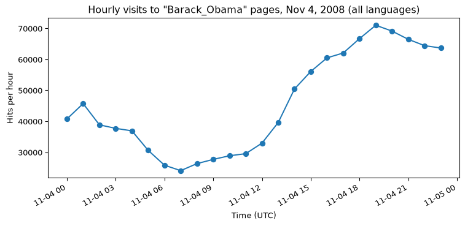
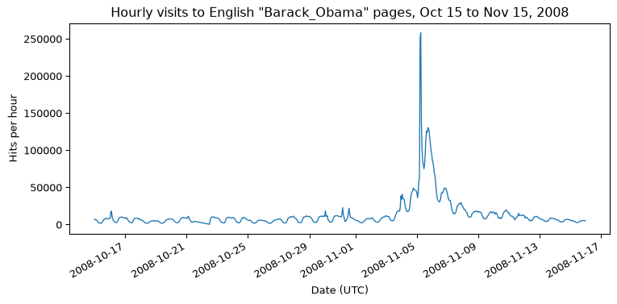
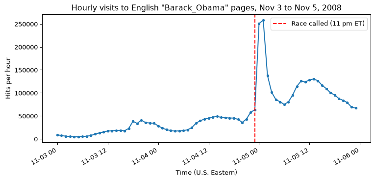

# Election Night on Wikipedia
Alexandru Tudor
2026-10-01

# Overview

How did public attention to Barack Obama change around the 2008 U.S.
presidential election? To answer this, I analyzed hourly Wikipedia
page-view logs for October 15 – November 15, 2008, using Python and Dask
on a Slurm-managed computing cluster. The month of data is about 40 GB
compressed and roughly 3.2 billion lines, too large to process
comfortably on one core, so the project is as much about building and
scaling a parallel pipeline as it is about the result.

**Key results**

- Processed about 3.2 billion log lines in **10.7 minutes** with a Dask
  pipeline running on 16 workers, submitted as a Slurm batch job.
- Traffic to English `Barack_Obama` pages, which averaged about **6,400
  hits per hour** before the election (with typical daily peaks near
  10,000), jumped to **over 250,000 hits per hour** in the two hours
  after the election was called (11 pm Eastern, November 4), more than
  25 times a typical daily peak.
- Validated every stage before scaling up: serial tests on single files,
  parallel tests on small subsets, and a check that interactive and
  batch runs on different nodes produced identical results.

**Tools:** Python, Dask (delayed tasks, bags, data frames), pandas,
matplotlib, Slurm, bash.

# Data

The data are hourly Wikipedia page-view counts from Wikimedia’s public
statistics, stored as gzipped, space-delimited files split into many
`part-*` files (the output format of a Spark job, which also writes an
empty `_SUCCESS` marker file that has to be skipped). Each line records
one page in one hour:

    date      time    language  page                    hits  size
    20081104  070000  en        President_Barack_Obama  1     38176

I worked with two versions of the data:

| Dataset | Period | Files | Size (compressed) | Used for |
|----|----|----|----|----|
| One day | November 4, 2008 (UTC) | 192 | 1.4 GB | Pipeline 1: delayed tasks, all languages |
| One month | Oct 15 – Nov 15, 2008 | 192 | ~40 GB | Pipeline 2: Dask bag, English pages only |

The raw files have a few quirks that the code has to handle: times such
as `010000` lose their leading zeros if read as numbers, some page
titles contain stray quote characters, some lines have fewer than six
fields, some timestamps carry stray seconds (e.g., `000001`), and each
file mixes records from many different days.

# Approach

Each file can be processed independently, which makes the problem
embarrassingly parallel: read a file, keep only the relevant records,
and combine the small filtered results at the end. I built two
pipelines:

1.  **One-day pipeline (Dask delayed).** One lazy task per file. Each
    task reads its file with pandas and returns only the rows whose page
    title contains `Barack_Obama`, so only a small data frame travels
    back to the main process. All tasks run in a single `dask.compute()`
    call.
2.  **Month-scale pipeline (Dask bag → data frame).** The month of data
    is read as a Dask bag, a distributed collection with one partition
    per file. A cheap substring check discards almost every line before
    the more expensive parsing step; the surviving records are converted
    to a Dask data frame and summed by day-hour, all in one pass over
    the data.

Design choices that apply to both:

- **Processes, not threads.** The parsing is mostly pure Python, which
  threads cannot run in parallel because of Python’s Global Interpreter
  Lock, so both pipelines use Dask’s `processes` scheduler. Each script
  keeps its Dask code inside an `if __name__ == "__main__":` block,
  because worker processes import the script.
- **Worker count from Slurm.** The number of workers comes from the
  `SLURM_NTASKS` environment variable, so it always matches the cores
  the scheduler allocated (no oversubscription, no idle cores).
- **Test small, then scale.** Every stage was checked serially on one
  file, then in parallel on 2–3 files, before the full run.
- **Data locality.** For the one-day data, which is read repeatedly
  during testing, I copied the files from network storage to the compute
  node’s local disk (`/tmp`) and deleted them afterwards. The month of
  data was already stored on each node’s local disk, so it was read in
  place.

The full scripts are in the [Appendix](#appendix-code).

# Pipeline 1: Election day with Dask delayed

## Setup

I requested an interactive session with 4 cores on one cluster node and
copied the one-day data to the node’s local disk. `$DAY_DATA` is the
location of the one-day dataset on the cluster.

``` bash
# interactive session: 4 cores on one node for one hour
srun -t 01:00:00 -N 1 --ntasks-per-node=4 --pty /bin/bash

# copy the data to this node's local disk
mkdir -p /tmp/$USER/wiki_day
cp $DAY_DATA/* /tmp/$USER/wiki_day/
ls /tmp/$USER/wiki_day | wc -l
du -sh /tmp/$USER/wiki_day
```

    193
    1.4G    /tmp/alexandrutudor/wiki_day

The 193 files are the 192 data files plus the `_SUCCESS` marker, which
the code skips by reading only `part-*` files.

## Reading and filtering

The core function, `read_and_filter()` in `filter_day.py`, reads one
file and keeps the matching rows. It reads date and time as strings to
keep leading zeros, treats quote characters as ordinary text
(`quoting=csv.QUOTE_NONE`), and supplies column names so short lines
become `NaN` instead of errors. I first ran it serially on one file:

``` bash
python - <<'EOF'
import glob, os, time
from filter_day import read_and_filter

# first data file (part-* skips _SUCCESS)
f = sorted(glob.glob(f"/tmp/{os.environ['USER']}/wiki_day/part-*"))[0]
t0 = time.time()
df = read_and_filter(f)
print(f"Time for one file: {time.time() - t0:.1f} sec")
print(df.shape)
print(df.head())
EOF
```

    Time for one file: 0.8 sec
    (36, 6)
               date    time   language                            page  hits    size
    13946  20081104  110000         eu                    Barack_Obama     2   20799
    43605  20081104  080000         pl  Specjalna:Eksport/Barack_Obama     1   79214
    43863  20081104  080000         pl   Specjalna:Export/Barack_Obama     1     951
    49053  20081104  070000  commons.m                    Barack_Obama    20  552411
    55655  20081104  070000         en          President_Barack_Obama     1   38176

At 0.8 seconds per file, processing all 192 files serially would take
about $192 \times 0.8 \approx 154$ seconds, or about 38 seconds on 4
workers with perfect speedup. After a 2-file parallel test reproduced
the serial results, I ran the full day:

``` bash
python filter_day.py /tmp/$USER/wiki_day obama_election_day.csv
```

    Processing 192 files with 4 workers
    Dask read + filter time: 66.5 sec
    Rows kept: 8274
    Saved to obama_election_day.csv

## Performance and reproducibility

| Run                                      | Workers | Time    | Rows kept |
|------------------------------------------|---------|---------|-----------|
| Serial estimate (0.8 s × 192 files)      | 1       | ~154 s  | —         |
| Interactive session (`srun`)             | 4       | 66.5 s  | 8,274     |
| Batch job (`sbatch`) on a different node | 4       | 124.6 s | 8,274     |

The interactive run achieved about a **2.3x speedup** on 4 workers,
short of the ideal 4x because of the cost of starting worker processes
(each one imports pandas), four workers reading from one disk at the
same time, and uneven file sizes. The GIL is not a factor here, since
each process has its own.

I then packaged the same steps as a Slurm batch job (`run_day.sh` in the
Appendix), which copies the data to whichever node Slurm assigns, runs
the pipeline, and deletes the copy, with a `trap` to clean up even if
Python fails. The batch job ran on a different node and kept exactly the
same 8,274 rows; its longer run time reflects a busier shared node,
since timings on a shared cluster vary between runs.

## Results: traffic over election day

To tabulate hits by hour, I parse the date and time with
`pd.to_datetime`, round each timestamp down to the hour, and sum the
hits. The two helper functions below are reused for the month-scale
analysis.

``` python
import pandas as pd
import matplotlib.pyplot as plt


def hourly_hits(df):
    """Total hits per hour from string date/time columns (UTC)."""
    ts = pd.to_datetime(df["date"] + df["time"],
                        format="%Y%m%d%H%M%S", utc=True)
    hits = pd.to_numeric(df["hits"], errors="coerce")
    # floor("h") also handles stray seconds such as 000001
    return (hits.groupby(ts.dt.floor("h")).sum()
            .rename_axis("timestamp").reset_index())


def plot_hits(times, hits, title, xlabel, **plot_args):
    """Line plot of hits over time; returns the axes for additions."""
    fig, ax = plt.subplots(figsize=(9, 4))
    ax.plot(times, hits, **plot_args)
    ax.set_xlabel(xlabel)
    ax.set_ylabel("Hits per hour")
    ax.set_title(title)
    fig.autofmt_xdate()
    return ax


# read date/time as strings to keep leading zeros
day = pd.read_csv("obama_election_day.csv", dtype={"date": str, "time": str})
hourly_day = hourly_hits(day)

plot_hits(hourly_day["timestamp"], hourly_day["hits"],
          'Hourly visits to "Barack_Obama" pages, Nov 4, 2008 (all languages)',
          "Time (UTC)", marker="o")
plt.show()
```



Traffic follows the U.S. day (Eastern time was UTC−5 that week). It
bottoms out at about 24,000 hits per hour at 07:00 UTC (2 am Eastern),
climbs steeply from 12:00 UTC as polls open, and peaks near 71,000 at
19:00 UTC (2 pm Eastern). This dataset ends at 23:00 UTC, before the
race was called at 11 pm Eastern (04:00 UTC on November 5), which
motivates the month-scale analysis.

# Pipeline 2: The full month with Dask bags

## Pipeline design

`count_month.py` builds the pipeline in four steps:

1.  **Read:** `db.read_text(files)` creates a bag of text lines with one
    partition per gzipped file.
2.  **Filter early:** `"Barack_Obama" in line` is a cheap check that
    discards nearly every line before any splitting.
3.  **Parse:** `parse_obama_en()` keeps lines with all six fields,
    language `en`, and `Barack_Obama` in the page title, and returns
    `(date, time, hits)`.
4.  **Aggregate:** the bag is converted to a Dask data frame and the
    hits are summed by `(date, time)`.

All four steps are lazy and run in a single `compute()` call, so the 40
GB of data are read only once. The run requires `pyarrow`, which Dask
uses to convert a bag to a data frame.

## Testing at small scale

A serial test on one file (16.6 million lines) kept 352 English records,
and showed that a single file contains records from many different days,
so the day-hour totals must be combined across all files:

    Lines read: 16605610, kept: 352
    [('20081105', '160000', 3),
     ('20081022', '230000', 3),
     ('20081024', '010000', 18),
     ('20081104', '110000', 1),
     ('20081104', '110000', 1)]

A parallel test of the full pipeline on 3 files took 39 seconds (about
40 seconds per file per core), which projected roughly
$192 \times 40 / 16 \approx 480$ seconds for the full month on 16 cores.

## Full run on 16 cores

The full run was submitted as a batch job with 16 cores on one node
(`run_month.sh` in the Appendix), reading the data in place from each
node’s local disk:

``` bash
sbatch run_month.sh
```

    Processing 192 files with 16 workers
    Dask read + filter + groupby time: 639.2 sec
    Number of day-hours: 744
    Saved to obama_month_counts.csv

The pipeline processed roughly 3.2 billion lines in **639 seconds (10.7
minutes)**, close to the projection once overhead and 16 workers sharing
one disk are taken into account. The result covers 744 of the 768 hours
from October 15 to November 15; 24 hours are missing from the source
data.

## Results: the month around the election

``` python
month = pd.read_csv("obama_month_counts.csv", dtype={"date": str, "time": str})
hourly_month = hourly_hits(month)

# the whole period (UTC)
plot_hits(hourly_month["timestamp"], hourly_month["hits"],
          'Hourly visits to English "Barack_Obama" pages, Oct 15 to Nov 15, 2008',
          "Date (UTC)", linewidth=1)
plt.show()

# zoom on Nov 3-5 in U.S. Eastern time, marking when the race was called
eastern = "US/Eastern"
zoom_start = pd.Timestamp("2008-11-03", tz=eastern)
zoom_end = pd.Timestamp("2008-11-06", tz=eastern)
race_called = pd.Timestamp("2008-11-04 23:00", tz=eastern)

times_et = hourly_month["timestamp"].dt.tz_convert(eastern)
in_window = (times_et >= zoom_start) & (times_et < zoom_end)
ax = plot_hits(times_et[in_window], hourly_month["hits"][in_window],
               'Hourly visits to English "Barack_Obama" pages, Nov 3 to Nov 5, 2008',
               "Time (U.S. Eastern)", marker="o", markersize=3)
ax.axvline(race_called, color="red", linestyle="--",
           label="Race called (11 pm ET)")
ax.legend()
plt.show()
```





Before the election, traffic to English `Barack_Obama` pages follows a
steady daily cycle, from overnight lows near 2,000 hits per hour to
daytime peaks near 10,000 (about 6,400 per hour on average). It then
spikes sharply after the election and decays over the following week
while staying above the pre-election level. (The straight segment around
October 21–22 is where the 24 missing hours fall.) Zooming in on
November 3–5, traffic rises through election day to about 60,000 hits
per hour by 11 pm Eastern, then jumps to over 250,000 hits per hour in
the two hours after the race was called. A second peak of about 130,000
follows around midday on November 5, as the rest of the country caught
up on the news.

# Takeaways

- **Filter as early as possible.** Returning only matching rows from
  each task (Pipeline 1) and discarding non-matching lines with a cheap
  substring check before parsing (Pipeline 2) kept data movement and
  parsing cost small.
- **Match the scheduler to the workload.** Pure-Python parsing needs
  separate processes to run in parallel; reading the worker count from
  Slurm avoids oversubscribing the allocated cores.
- **One pass over the data.** Building the whole computation lazily and
  running it with one `compute()` call avoids rereading 40 GB.
- **Speedup is never free.** Process startup, disk contention, and
  uneven task sizes held the 4-worker speedup to about 2.3x, and run
  times on a shared cluster varied by nearly 2x between nodes.
- **Validate before scaling.** Serial checks, small parallel tests, and
  comparing interactive and batch runs caught data quirks (the
  `_SUCCESS` file, stray seconds, missing fields) before the expensive
  full runs.

# Appendix: code

<details class="code-fold">
<summary>Code</summary>

``` python
from pathlib import Path

for script in ["filter_day.py", "count_month.py", "run_day.sh", "run_month.sh"]:
    print(f"# ===== {script} =====")
    print(Path(script).read_text())
```

</details>

    # ===== filter_day.py =====
    """
    Election-day Wikipedia traffic: parallel filtering with Dask delayed

    Read the Wikipedia traffic files in parallel with Dask (one delayed
    task per file), keep rows whose page title contains "Barack_Obama",
    and combine the results into one pandas data frame saved to disk.

    Usage:
        python filter_day.py <data_dir> [output_csv]
        N_TEST_FILES=2 python filter_day.py <data_dir>   # small test first
    """

    import csv
    import glob
    import os
    import sys
    import time

    import dask
    import pandas as pd

    pd.set_option("display.max_columns", None)  # show all columns
    pd.set_option("display.width", 200)         # don't wrap output

    COLS = ["date", "time", "language", "page", "hits", "size"]


    def read_and_filter(path, pattern="Barack_Obama"):
        """Read one file; keep rows whose page contains `pattern`."""
        df = pd.read_csv(
            path,
            sep=" ",
            header=None,
            names=COLS,                  # short lines -> NaN, not error
            dtype={"date": str, "time": str},  # keep leading zeros
            quoting=csv.QUOTE_NONE,      # quotes are literal text
            on_bad_lines="skip",         # skip lines with > 6 fields
        )
        keep = df["page"].str.contains(pattern, regex=False, na=False)
        return df.loc[keep]              # return only matching rows


    def main():
        default_dir = f"/tmp/{os.environ.get('USER', 'user')}/wiki_day"
        data_dir = sys.argv[1] if len(sys.argv) > 1 else default_dir
        out_file = sys.argv[2] if len(sys.argv) > 2 else "obama_election_day.csv"

        # number of workers = cores Slurm gave us
        n_workers = int(os.getenv("SLURM_NTASKS",
                                  os.getenv("SLURM_CPUS_PER_TASK", 4)))

        # part-* skips the empty _SUCCESS file
        files = sorted(glob.glob(os.path.join(data_dir, "part-*")))
        n_test = os.getenv("N_TEST_FILES")
        if n_test is not None:           # optional small test
            files = files[: int(n_test)]
        print(f"Processing {len(files)} files with {n_workers} workers",
              flush=True)

        # processes scheduler: pure-Python parsing, avoids the GIL
        dask.config.set(scheduler="processes", num_workers=n_workers)
        # lazy tasks, one per file (nothing runs yet)
        tasks = [dask.delayed(read_and_filter)(f) for f in files]

        t0 = time.time()
        results = dask.compute(tasks)[0]  # run all tasks in parallel
        print(f"Dask read + filter time: {time.time() - t0:.1f} sec",
              flush=True)

        obama = pd.concat(results, ignore_index=True)  # one data frame
        print(f"Rows kept: {len(obama)}")
        print(obama.head())

        obama.to_csv(out_file, index=False)
        print(f"Saved to {out_file}")


    # workers import this file; only run main() when executed directly
    if __name__ == "__main__":
        main()
    # ===== count_month.py =====
    """
    Month-scale Wikipedia traffic: Dask bag pipeline

    Use a Dask bag (a distributed data structure) to read the
    Wikipedia files and keep English pages whose title contains
    "Barack_Obama". Convert the bag to a Dask data frame, sum hits by
    day-hour, and save the counts to a CSV.

    Usage:
        python count_month.py <data_dir> [output_csv]
        N_TEST_FILES=3 python count_month.py <data_dir> test_month.csv
    """

    import glob
    import os
    import sys
    import time

    import dask
    import dask.bag as db
    import pandas as pd

    pd.set_option("display.max_columns", None)
    pd.set_option("display.width", 200)


    def parse_obama_en(line):
        """Return (date, time, hits) for an English Obama line, else None."""
        vals = line.split(" ")
        # need 6 fields, English, Obama in page title
        if (len(vals) != 6 or vals[2] != "en"
                or "Barack_Obama" not in vals[3]):
            return None
        try:
            hits = int(vals[4])
        except ValueError:               # hits field not a number
            return None
        return (vals[0], vals[1], hits)


    def main():
        data_dir = sys.argv[1]
        out_file = (sys.argv[2] if len(sys.argv) > 2
                    else "obama_month_counts.csv")

        # number of workers = cores Slurm gave us
        n_workers = int(os.getenv("SLURM_NTASKS",
                                  os.getenv("SLURM_CPUS_PER_TASK", 4)))
        # processes scheduler: pure-Python parsing, avoids the GIL
        dask.config.set(scheduler="processes", num_workers=n_workers)

        # part-* skips the empty _SUCCESS file
        files = sorted(glob.glob(os.path.join(data_dir, "part-*")))
        n_test = os.getenv("N_TEST_FILES")
        if n_test is not None:           # optional small test
            files = files[: int(n_test)]
        print(f"Processing {len(files)} files with {n_workers} workers",
              flush=True)

        # bag of lines; each file is a partition
        wiki = db.read_text(files)

        obama = (
            wiki.filter(lambda line: "Barack_Obama" in line)  # cheap first
            .map(parse_obama_en)                  # line -> tuple or None
            .filter(lambda rec: rec is not None)  # drop non-matches
        )

        # bag -> Dask data frame, then sum hits by day-hour (still lazy)
        ddf = obama.to_dataframe(
            meta={"date": str, "time": str, "hits": int})
        counts_lazy = ddf.groupby(["date", "time"])["hits"].sum()

        t0 = time.time()
        counts = counts_lazy.compute()   # one pass: read, filter, group
        print(f"Dask read + filter + groupby time: "
              f"{time.time() - t0:.1f} sec", flush=True)

        counts = (counts.reset_index()
                  .sort_values(["date", "time"])
                  .reset_index(drop=True))
        print(f"Number of day-hours: {len(counts)}")
        print(counts.head(10))

        counts.to_csv(out_file, index=False)
        print(f"Saved to {out_file}")


    # workers import this file; only run main() when executed directly
    if __name__ == "__main__":
        main()
    # ===== run_day.sh =====
    #!/bin/bash
    # Slurm settings: 4 cores on 1 node, 30 min
    #SBATCH --job-name=wiki_day
    #SBATCH --partition=low
    #SBATCH --nodes=1
    #SBATCH --ntasks-per-node=4
    #SBATCH --time=00:30:00
    #SBATCH --output=run_day.out
    #SBATCH --error=run_day.err

    # one-day dataset; set before submitting: DAY_DATA=/path/to/data sbatch run_day.sh
    DATA_SRC=${DAY_DATA:?set DAY_DATA to the one-day data directory}
    TMP_DATA=/tmp/$USER/wiki_day
    # delete the copy on exit, even if Python fails
    trap 'rm -rf "$TMP_DATA"' EXIT

    # copy to /tmp on whichever node Slurm picks
    mkdir -p "$TMP_DATA"
    cp "$DATA_SRC"/* "$TMP_DATA"/
    echo "Running on $(hostname); copied $(ls "$TMP_DATA" | wc -l) files"

    python filter_day.py "$TMP_DATA" obama_election_day.csv
    # clean up /tmp (shared, only cleared on reboot)
    rm -rf "$TMP_DATA"
    # ===== run_month.sh =====
    #!/bin/bash
    # Slurm settings: 16 cores on 1 node, 90 min
    #SBATCH --job-name=wiki_month
    #SBATCH --partition=low
    #SBATCH --nodes=1
    #SBATCH --ntasks-per-node=16
    #SBATCH --time=01:30:00
    #SBATCH --output=run_month.out
    #SBATCH --error=run_month.err

    # month dataset, read in place from each node's local disk
    # set before submitting: MONTH_DATA=/path/to/data sbatch run_month.sh
    MONTH_DATA=${MONTH_DATA:?set MONTH_DATA to the month data directory}
    echo "Running on $(hostname) with $SLURM_NTASKS tasks"
    python count_month.py "$MONTH_DATA" obama_month_counts.csv
